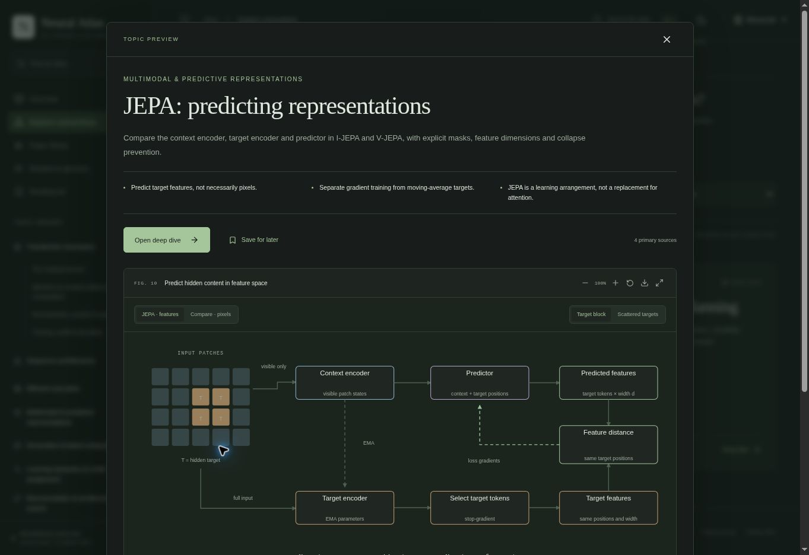

# Artificial Neural Architectures — Atlas

**Live website:** [Artificial Neural Architectures — Atlas](https://pzarzycki.github.io/mac-lab-ann-arch/)

An interactive research guide for individual exploration of neural architectures, learning algorithms and embodied intelligence.

**42 deep dives · 6 domains with nested families · 84 primary references.** Worked-mechanism revision: 22 October 2026.

Browse a group, inspect a concise topic preview and its live visual, open the detailed article, then follow explained connections to related ideas. Question collections offer alternative views of the same content. The interface has no lessons, required order, grades or completion tracking.

New coverage includes **JEPA/I-JEPA/V-JEPA, video world models and latent planning, NEAT and HyperNEAT**. Every deep dive has a computed interactive SVG or numerical lab. Worked examples expose inputs, intermediate values, outputs and assumptions; the historical timeline explains each contribution. All 33 original article URLs remain valid.



## Run locally

Use Node.js 20.19+ or a compatible newer release:

```bash
npm ci
npm run dev
```

Open the URL Vite prints (normally port 4173). All interactions execute locally in the browser. No application backend, model API key, account system or remote font service is needed.

```bash
npm run check       # citations, links, previews, visuals, relationships, strict TeX
npm run check:visuals # render every actual visual; validate concept graph geometry
npm test            # numerical invariants, finite differences and mechanism checks
npm run manuscript  # export the synchronized manuscript and bibliography
npm run build       # validated static production output in dist/
npm run preview     # serve production output locally
```

## Content and conspect

- `docs/CONSPECT.md`: topic map, all implemented deep dives, crosslinks and future coverage register.
- `docs/PLAN.md`: editorial decisions, implementation and maintenance.
- `docs/MANUSCRIPT.md`: generated article text, key points, related topics and primary references.
- `docs/VALIDATION.md`: verification evidence and known limits.
- `src/content/articles/*.md`: article bodies with TeX and highlighted fenced code.
- `src/content/articles.json`: abstracts, three key points, technique tags, citations, visuals and explained connections.
- `src/content/categories.json`: topic groups and their connections.
- `src/content/collections.json`: unordered question-based exploration collections.
- `src/content/sources.json`: primary bibliography and review provenance.
- `src/components/Explore.jsx`: topic cards, quick views, directory and related-topic navigation.
- `src/components/*Figures.jsx` and `*Mechanisms.jsx`: semantic SVG diagrams and interactive calculations.
- `docs/REVIEW-IMPLEMENTATION.md`: page-by-page record of the audit recommendations implemented.
- `src/content/visuals.json`: registry connecting article visual IDs to renderer families.
- `src/math.js`: numerical calculations; see `tests/math.test.mjs`.

Add Markdown and metadata together. Declare references in their numbered order; inline `[1](#ref-source-id)` citations are validated. Article links use `#/article/slug`. Each article must have three preview points, tags, a resolved visual and at least three explained related-topic links. Run the checks and manuscript export before publication.

The conspect distinguishes existing treatment from topics awaiting further research. A mention or tag does not claim a complete survey, and future coverage is not represented by empty articles.

## Rendering and navigation

React/Vite; Markdown through react-markdown, GFM and math plugins; KaTeX HTML/MathML; rehype-highlight for code. SVG figures support inspection, zoom, expansion and vector export. Diagrams preserve separate token streams and distinguish heads, residual lanes, experts and time. Bright/dark/system themes and bookmarks use browser-local storage.

Search covers titles, technique tags and article text. The directory can filter by topic group and cross-field question; question cards explain each topic’s role. The manuscript has full-text filtering and direct topic jumps. Glossary search resolves common aliases such as LN, QKV and GQA. Related-topic links explain their relationship instead of imposing a global previous/next order. Old article URLs remain stable; old category URLs and `#/paths` have compatible aliases.

Illustrative masks, mutations, coordinate fields and latent rollouts are labeled as such. These interactions are not trained models, reproduced benchmark runs or robot controllers. Numerical calculations and paper evidence retain their separate assumptions.

## Static deployment

`npm run build` emits `dist/`. Publish that directory to any static host. Vite uses relative asset paths, including under a subdirectory. Hash routes do not require a server-side fallback. No runtime secrets are required. `.openai/hosting.json` associates the existing private Site; it is deployment metadata, not an application backend.

## GitHub

Repository: https://github.com/pzarzycki/mac-lab-ann-arch

```bash
git clone git@github.com:pzarzycki/mac-lab-ann-arch.git
cd mac-lab-ann-arch
npm ci
npm run dev
```

The repository contains editable source, the conspect, generated manuscript and bibliography. Build output and dependencies are excluded from Git.

## Luminous Editorial interface

Six domains contain nested families and all 42 original deep dives. The porcelain/iris visual system includes a corresponding dark theme. The Manuscript navigation opens `#/manuscript`, rendering the same article Markdown with KaTeX, highlighted code, scoped citation anchors and expandable sections. No download is triggered. Legacy article and section URLs remain available. `docs/CONSPECT.md` records the complete hierarchy.

## GitHub Pages

The `Deploy Atlas to GitHub Pages` workflow validates the numerical examples, builds with `npm ci` / `npm run build`, uploads `dist/`, and publishes using GitHub's official Pages actions. It runs on pushes to `main` and can be started manually. Third-party action references are pinned to verified GitHub-owned action commits.

One-time repository setup: open **Settings → Pages → Build and deployment → Source** and select **GitHub Actions**. If the initial deployment ran before this setting was enabled, rerun `Deploy Atlas to GitHub Pages` from the Actions tab. No personal token or repository secret is needed.

The GitHub Pages target URL is `https://pzarzycki.github.io/mac-lab-ann-arch/`. Vite's relative asset base (`./`) and hash routes support this repository subdirectory without a server fallback. The existing ChatGPT-hosted URL remains a separate deployment.

## Link sharing preview

The initial HTML includes Open Graph and large-image card metadata, including the Atlas title, description, canonical public URL and an absolute public image URL. The branded banner is `public/social/atlas-preview-v1.jpg` (1200 × 630, approximately 103 KB), matching the porcelain/iris interface. It is copied to `dist/social/` during build and can be fetched without JavaScript or sign-in.

Share `https://pzarzycki.github.io/mac-lab-ann-arch/` for the public website. All hash-based article URLs currently use the same Atlas preview; individual article previews would require separately served HTML URLs. Preview clients can retain previously fetched cards, so a newly published card may not appear immediately in every client. When replacing the artwork, use a new versioned filename and update the metadata together.

## Embeddings and Transformer observability

Token embeddings & embedding space is a dedicated Core mechanisms deep dive. The Observability & interpretability family covers instrumentation and evidence, logit/tuned lenses, the Jacobian lens and J-space, plus activation patching, sparse features, transcoders and circuit tracing. The primary-source registry and manuscript include these additions. Interactive figures are labeled synthetic where they compute invented examples. Manuscript is available in the top-right header.
